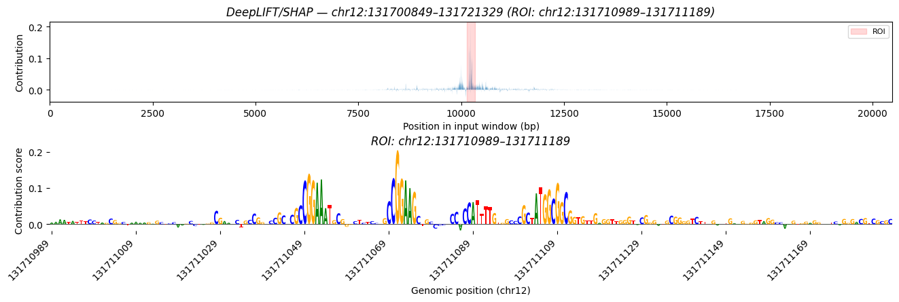
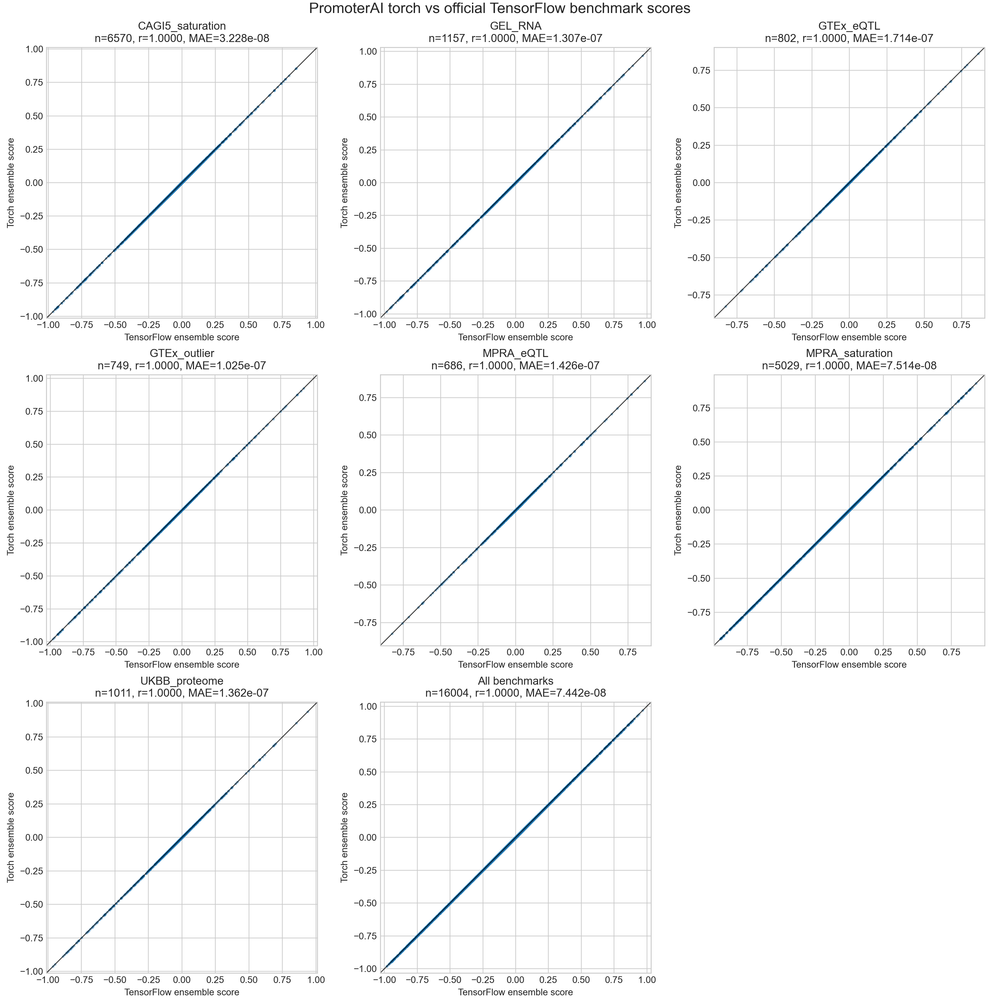

# promoterai-torch

[](https://pypi.org/project/promoterai-torch/) [](https://github.com/genomicsxai/promoterai-torch/actions/workflows/tests.yml) [](https://pepy.tech/projects/promoterai-torch)

A PyTorch port of [PromoterAI](https://github.com/Illumina/PromoterAI) v1 from Illumina — a deep learning model that predicts the regulatory impact of promoter DNA variants on gene expression.

> [!Important]
> This is **not** an official Illumina product or publication. The contents of this package are solely the responsibility of the authors/maintainers and its release should not be construed as being supported/endorsed by Illumina or the original authors of PromoterAI.
>
> The official PromoterAI codebase is released under the [PolyForm Strict License 1.0.0](https://polyformproject.org/licenses/strict/1.0.0/). The pretrained models and precomputed variant scores are released separately under Illumina's own academic-only-use data license (see [their github](https://github.com/Illumina/PromoterAI) for instructions on academic/commercial licensing). This package is MIT-licensed and contains no Illumina code, models, or scores, but official PromoterAI models are bound by Illumina's license terms, even after being converted. Please do not redistribute converted checkpoints.

## Install

Python 3.10–3.14 are supported.

```sh
pip install promoterai-torch        # or: uv add promoterai-torch
```

The core package scores variants, extracts embeddings, runs inference and
converts the official Keras models (no TensorFlow needed). Optional extras:

| Extra       | Enables                                              |
| ----------- | ---------------------------------------------------- |
| `train`     | Preprocess data, train from scratch, or fine-tune    |
| `wandb`     | Weights & Biases logging (combine with `train`)      |
| `interpret` | DeepLIFT/SHAP references and logo plots (tangermeme) |

PyPI's `torch` supports NVIDIA GPUs of compute capability 7.5+ (Turing and
newer). For older GPUs (Maxwell, Pascal, Volta) or CPU-only machines, see
[docs/installation.md](docs/installation.md). For a development checkout, see
[CONTRIBUTING.md](CONTRIBUTING.md).

## Convert a pretrained Keras model

Download a pretrained PromoterAI SavedModel from
[Illumina/PromoterAI](https://github.com/Illumina/PromoterAI) and convert it
(architecture parameters are inferred from the SavedModel):

```sh
promoterai-torch convert \
    --keras_model models/promoterAI_v1_hg38_mm10_finetune \
    --output models/promoterAI_v1_hg38_mm10_finetune.pt \
    --input_length 20480 --output_length 4096   # stored in the checkpoint
```

## Score variants

Given a variant TSV with columns `chrom`, `pos`, `ref`, `alt`, `strand`:

```sh
promoterai-torch score \
    --model_checkpoint models/promoterAI_v1_hg38_mm10_finetune.pt \
    --var_file variants.tsv \
    --fasta_file hg38.fa \
    --input_length 20480
```

Scores in [−1, 1] are written to `variants.{model_name}.tsv` (or `--output`).
Thresholds: ±0.1 (weak), ±0.2 (moderate), ±0.5 (strong). Substitutions are
scored incrementally by default: each site's reference runs once and each alt
recomputes only what its edit can reach, exactly (5x faster on TERT promoter
SNVs). Indels use full passes; `--no-incremental` forces full passes for all.

## Predict tracks and extract embeddings

```python
import torch
from promoterai_torch.dataset import onehot_encode
from promoterai_torch.utils import load_pretrained

model, args = load_pretrained("models/promoterAI_v1_hg38_mm10_finetune.pt")
model.eval()

seq = "ACGT" * (args["input_length"] // 4)   # your 20,480-bp sequence
x = torch.from_numpy(onehot_encode(seq)).unsqueeze(0)   # (1, L, 4)

with torch.no_grad():
    tracks = model(x)             # one (1, output_length, n_tracks) tensor per species head
    embeddings = model.encode(x)  # (1, L, model_dim), the final block's output
```

Tracks are arcsinh-scale signal: 498 for the human head (histone marks, TF
ChIP-seq, ATAC-seq, RNA-seq) and 472 for the mouse head.

## DeepLIFT/SHAP attribution

With the `interpret` extra, `deep_lift_shap` gives the same attributions as
[tangermeme](https://github.com/jmschrei/tangermeme)'s, but the full model fits
on a 10 GB GPU (tangermeme needs ~65 GB):

```python
from promoterai_torch.attribution import deep_lift_shap

# X: (N, 4, input_length) one-hot, channels-first
attributions = deep_lift_shap(model.to("cuda"), X, n_shuffles=20, random_state=0)
```

See [docs/attribution.md](docs/attribution.md) for options, `compile=True`,
precision on Ampere+ GPUs, and benchmarks.



## Numerical equivalence

This port produces near-identical scores and regulatory track predictions to
the original TensorFlow/Keras implementation, matching the published AUROCs.
See [docs/numerical-equivalence.md](docs/numerical-equivalence.md) for
benchmark reproduction steps, per-variant concordance results, and
full-track comparison scripts.



## Training models

Fine-tuning or training from scratch using the built-in scripts requires the
`train` extra described in [Install](#install) (with an optional `wandb` extra
for wandb.ai integration. See [docs/training.md](docs/training.md) for data
preprocessing, training from scratch, fine-tuning on variants, and multi-GPU usage.

## Development

See [CONTRIBUTING.md](CONTRIBUTING.md) for setting up a local development
environment and running the test suite.

## Reference

Jaganathan, Ersaro, Novakovsky et al. *Science* (2025) Predicting expression-altering promoter mutations with deep learning. doi:10.1126/science.ads7373

He, Kundaje. *Genomics x AI Blog* (2026) [promoterai-torch: a PyTorch port of Illumina's PromoterAI](https://genomicsxai.github.io/blogs/2026-014/). doi:10.5281/zenodo.23038831

Original TF implementation: [Illumina/PromoterAI](https://github.com/Illumina/PromoterAI)

Citation metadata for this software is available in [CITATION.cff](CITATION.cff).
