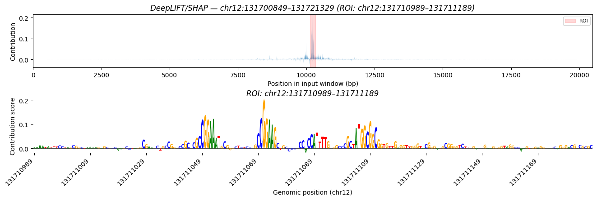

# DeepLIFT/SHAP attribution

Install the optional interpretation dependencies first (tangermeme generates the
shuffled references and draws the logo plots):

```sh
pip install "promoterai-torch[interpret]"
# or
uv add promoterai-torch --extra interpret
```

`promoterai_torch.attribution.deep_lift_shap` computes DeepLIFT/SHAP attributions of
the model's mean prediction with an engine written for this architecture. It gives
the same attributions as [`tangermeme`](https://github.com/jmschrei/tangermeme)'s
`deep_lift_shap` (same dinucleotide-shuffled references for a given `random_state`,
same rescale rule), but the full published model fits on a 10 GB GPU:

```python
from promoterai_torch.attribution import deep_lift_shap
from promoterai_torch.utils import load_pretrained

model, args = load_pretrained("model.pt")
model = model.to("cuda")

# X: (N, 4, input_length) one-hot, channels-first (tangermeme's layout)
attributions, deltas = deep_lift_shap(
    model, X,
    head=0,             # which species head
    tracks=None,        # or a list of track indices; the output is their mean
    n_shuffles=20, random_state=0,
    return_deltas=True, # |sum(attr) - (y(x) - y(ref))| per reference, ~1e-7 in float32
)
# attributions: (N, 4, input_length) on the CPU, already multiplied by X
# (hypothetical=True returns every base's attribution instead)
```

## Choosing a head

Multi-species checkpoints (`hg38_mm10`) have one output head per species, and
`head=` picks the one to attribute. Heads follow the checkpoint's `species_order`,
which records the real order rather than assuming human comes first, so look the
index up instead of hard-coding it:

```python
mouse = args["species_order"].index("mouse")   # ['human', 'mouse'] for hg38_mm10
attributions = deep_lift_shap(model, X, head=mouse, n_shuffles=20, random_state=0)
```

`examples/deepliftshap_region.py --species mouse` does the same lookup.

## Custom targets

By default the attributed quantity is the head's mean prediction over its output
window and the selected `tracks`. `target_weights=` attributes any weighted sum of
the prediction instead: `(prediction * target_weights).sum()`, with
`target_weights` broadcastable to `(output_length, n_tracks)` (4096 × 498 for the
published human head). It's exact under the same rescale rule, and matches
tangermeme on a wrapper that computes the same sum.

```python
L_out, D = 4096, 498

# Mean over a +-250 bp window around the TSS (the output window's center), all tracks
w = torch.zeros(L_out, 1)
w[L_out // 2 - 250 : L_out // 2 + 250] = 1 / (500 * D)

# Per-track weights, e.g. a signed contrast between two tracks
w = torch.zeros(D)
w[track_a], w[track_b] = 1.0, -1.0   # indices into the head's track list

attributions = deep_lift_shap(model, X, target_weights=w, n_shuffles=20, random_state=0)
```

A `(n_tracks,)` tensor weights tracks, `(output_length, 1)` weights positions, and a
full `(output_length, n_tracks)` tensor weights both. Normalization is up to you:
weights summing to 1 give a mean, and unnormalized weights give a sum, which also
scales the convergence deltas. `target_weights` and `tracks` are exclusive.
Non-linear aggregations (max, log, ratios) aren't supported.

## Memory, batching and `compile=True`

How many references (and, for very short sequences, how many sequences) go through
the GPU per step is chosen to saturate it within the free device memory (at the
published scale, up to 4 references per step: ~16 GB, ~10% faster than 1 on an A100;
12 GB cards fit 2, 10 GB cards 1); pass `ref_chunk` / `batch_size` / `max_memory` to
override it. `compile=True` fuses the
elementwise work: `torch.compile` on CPUs and CUDA GPUs of compute capability 7.0+,
and TorchScript's fuser on older GPUs (e.g. Pascal), where `torch.compile`'s Triton
backend doesn't run. Both are measured below: TorchScript on Pascal is ~12% faster,
and `torch.compile` is ~21% faster on an RTX 3080 and 12-40% faster on an A100 once
compiled (the first call adds 12-70 s of compilation), agreeing with eager to a
relative L2 of ~1e-7. `torch.compile` here needs torch >= 2.6; eager mode works from
torch 2.1.

## Precision and TF32

On Ampere and newer GPUs, PyTorch runs convolutions in TF32 by default
(`torch.backends.cudnn.allow_tf32 = True`), so GPU attributions differ from
tangermeme's by a relative L2 of ~1e-4 (2.7e-4 measured on an RTX 3080). This is
floating-point noise, not an engine difference, and it matches the original
TensorFlow model, which also uses TF32 on these GPUs. For an exact comparison, set
`torch.backends.cudnn.allow_tf32 = False` first; the gap then drops to ~1e-7, at no
cost in speed (1.7e-6 at the published scale on an A100, where the default gives 3e-4).

Turning TF32 on for matmuls too (`torch.backends.cuda.matmul.allow_tf32 = True`, off
by default) makes both implementations ~3x faster on an A100, at ~2e-4 relative L2
from strict float32 on the real hg38 model (~3e-3 on random weights) and convergence
deltas ~1e-3 instead of ~1e-6: fine for logo plots, not for exact checks.

## Benchmarks

Full published model (24 blocks x 1024, 20,480 bp), one sequence x 20 shuffles,
float32 with PyTorch's default precision flags unless noted (A100 rows: strict
float32, or TF32 for both convolutions and matmuls):

| Hardware | Method | Time | Peak GPU memory |
| --- | --- | --- | --- |
| A100 80 GB | `tangermeme.deep_lift_shap`, `batch_size=1` | 44 s | 65.5 GB |
| A100 80 GB | `deep_lift_shap` | 32 s | 15.6 GB |
| A100 80 GB | `deep_lift_shap(compile=True)` | 28 s | 14.1 GB |
| A100 80 GB, TF32 | `tangermeme.deep_lift_shap`, `batch_size=1` | 14 s | 65.5 GB |
| A100 80 GB, TF32 | `deep_lift_shap` | 9.9 s | 15.6 GB |
| A100 80 GB, TF32 | `deep_lift_shap(compile=True)` | 5.9 s | 14.1 GB |
| TITAN X (Pascal) 12 GB | `tangermeme.deep_lift_shap` | out of memory | |
| TITAN X (Pascal) 12 GB | `deep_lift_shap` | 96 s | 6.5 GB |
| TITAN X (Pascal) 12 GB | `deep_lift_shap(compile=True)` | 86 s | 7.7 GB |
| TITAN Xp 12 GB | `deep_lift_shap` | 78 s | 6.5 GB |
| TITAN Xp 12 GB | `deep_lift_shap(compile=True)` | 70 s | 7.7 GB |
| RTX 3080 10 GB | `tangermeme.deep_lift_shap` | out of memory | |
| RTX 3080 10 GB | `deep_lift_shap` | 40 s | 6.5 GB |
| RTX 3080 10 GB | `deep_lift_shap(compile=True)` | 32 s | 5.9 GB |

## Examples

`examples/deepliftshap_region.py` attributes a genomic region and plots it;
`examples/benchmark_deep_lift_shap.py` compares the two implementations at reduced
width; `examples/benchmark_deep_lift_shap_compile.py` times eager vs `compile=True`
on a real checkpoint.



## Other attribution targets or methods

The engine relies on PromoterAI's structure (ReLU as the only nonlinearity,
eval-mode BatchNorm, row-wise ops). For other attribution targets or methods, the
model still works with tangermeme directly: its non-linearities are distinct
`nn.ReLU()` modules, as tangermeme requires. Wrap it to take `(B, 4, L)` and return
`(B, n_targets)`, e.g. `model(x.transpose(1, 2))[0].mean(dim=(1, 2)).unsqueeze(1)`.
