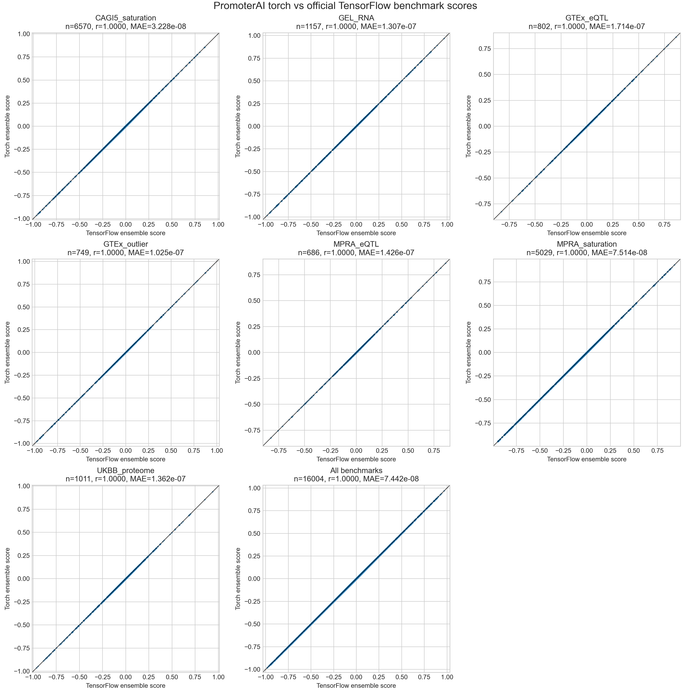
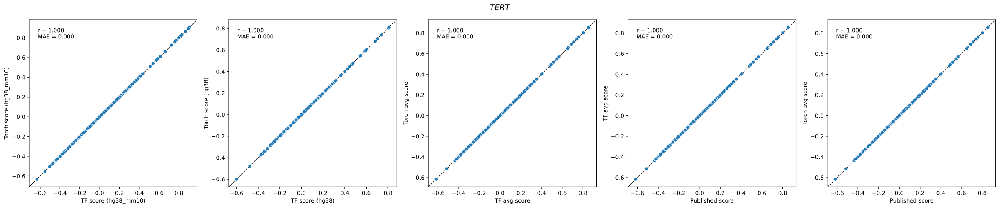
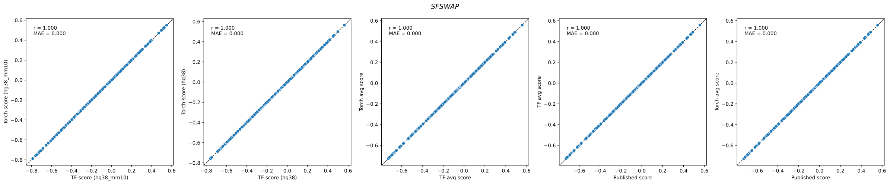
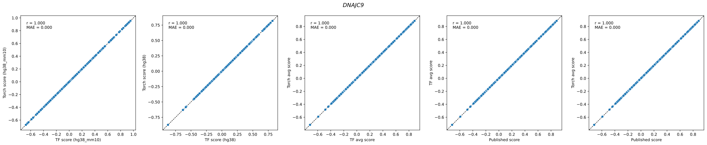

# Numerical equivalence

## Equivalence on benchmarks from paper

The public benchmark variant sets from
[Illumina/PromoterAI](https://github.com/Illumina/PromoterAI/tree/master/data/benchmark)
can be downloaded and scored with fine-tuned torch checkpoints. The
benchmark script reports under/over, under/null, and over/null AUROCs from
`hg38_finetune` scores, or from the average of signed `hg38_finetune` and
`hg38_mm10_finetune` variant scores when both checkpoints are provided:

```sh
python examples/paper_benchmark/download_benchmark_data.py \
    --output_dir data/benchmark

python examples/paper_benchmark/benchmark_variant_scores.py \
    --benchmark_dir data/benchmark \
    --hg38_finetune_checkpoint models/promoterAI_v1_hg38_finetune.pt \
    --hg38_mm10_finetune_checkpoint models/promoterAI_v1_hg38_mm10_finetune.pt \
    --fasta_file hg38.fa \
    --output_dir results/benchmark \
    --batch_size 2 \
    --device cuda
```

Per-dataset scored TSVs are written to `results/benchmark/*.scores.tsv`, and
the AUROC summary is written to `results/benchmark/benchmark_aurocs.tsv`.
Run one or more datasets by adding `--dataset GTEx_outlier` (repeatable). To
split each dataset across multiple GPUs, pass a device list:

```sh
python examples/paper_benchmark/benchmark_variant_scores.py \
    --benchmark_dir data/benchmark \
    --dataset GTEx_outlier \
    --hg38_finetune_checkpoint models/promoterAI_v1_hg38_finetune.pt \
    --hg38_mm10_finetune_checkpoint models/promoterAI_v1_hg38_mm10_finetune.pt \
    --fasta_file hg38.fa \
    --output_dir results/benchmark/GTEx_outlier \
    --batch_size 2 \
    --devices cuda:0 cuda:1 cuda:2 cuda:3
```

Omit `--hg38_mm10_finetune_checkpoint` to benchmark with only the
`hg38_finetune` checkpoint.

Like `promoterai-torch score`, the benchmark scores substitutions incrementally by
default (one cached reference pass per variant site; see the README's scoring
section), and every benchmark variant is a substitution. Multi-device runs shard
by site, so a site's variants share that pass. On 100-variant subsets with
`hg38_finetune` on a TITAN Xp, this took GTEx_outlier (99 sites) from 351 to 152 s
and CAGI5_saturation (63 sites) from 353 to 105 s, with identical scores and
AUROCs. Pass `--no-incremental` for full ref/alt passes.

To benchmark the official TensorFlow/Keras SavedModels from
[Illumina/PromoterAI](https://github.com/Illumina/PromoterAI), install the
official `promoterai` package in an environment with TensorFlow and use the
matching TensorFlow script. This standalone script does not require installing
`promoterai-torch`.

```sh
python examples/paper_benchmark/benchmark_variant_scores_tf.py \
    --benchmark_dir data/benchmark \
    --dataset GTEx_outlier \
    --hg38_finetune_model_folder models/promoterAI_v1_hg38_finetune \
    --hg38_mm10_finetune_model_folder models/promoterAI_v1_hg38_mm10_finetune \
    --fasta_file hg38.fa \
    --output_dir results/benchmark_tf/GTEx_outlier \
    --batch_size 1 \
    --devices 0 1 2 3
```

After running both benchmark paths, open
`examples/paper_benchmark/plot_torch_vs_tensorflow_scores.ipynb` to make
per-dataset and combined scatterplots of torch versus TensorFlow ensemble
scores. This port and the original TF model produce near equivalent scores, and both also match the published AUROCs.



## Equivalence on (subset of) published all-promoter variants dataset

Validated the `hg38_finetune` and `hg38_mm10_finetune` models against the original TF/Keras implementation on *TERT* (*n* = 6,006), *SFSWAP* (*n* = 3003), and *DNAJC9* (*n* = 9009) promoter variants. Scores are identical across all comparisons, including the ensembled scores against the published PromoterAI variant scores (Pearson r = 1.0000, MAE = 0.0000). See `examples/` for details. Note that this repo follows the official PromoterAI and rounds variant scores to 4 decimal places.





The example scripts can also compare the full predicted regulatory tracks from the original TF/Keras SavedModel and the converted PyTorch checkpoint. This reports mean and max absolute error per input sequence and output head.

```sh
python examples/track_benchmark/compare_tf_torch_tracks_promoters.py \
    --keras_model models/promoterAI_v1_hg38_mm10_finetune \
    --torch_checkpoint models/promoterAI_v1_hg38_mm10_finetune.pt \
    --fasta hg38.fa \
    --promoter DNAJC9:chr10:73247254:- \
    --promoter TERT:chr5:1294988:- \
    --promoter SFSWAP:chr12:131710589:+

python examples/track_benchmark/compare_tf_torch_tracks_random.py \
    --keras_model models/promoterAI_v1_hg38_mm10_finetune \
    --torch_checkpoint models/promoterAI_v1_hg38_mm10_finetune.pt \
    --n_sequences 8 \
    --seed 0
```

Both track parity scripts default to a VRAM-safe separate-loop mode: TensorFlow
runs first in a child process, writes temporary memmaps, exits to release CUDA
memory, and then PyTorch runs. Pass `--interleaved` only for small debugging
runs where both runtimes fit in GPU memory.

Errors are ~1e-7 (<1e-4) when run at FP32, i.e., within machine precision, when comparing all four official TF/Keras SavedModels (`hg38`, `hg38_mm10`, `hg38_finetune`, and `hg38_mm10_finetune`) against their PyTorch checkpoints.

## DeepLIFT/SHAP attributions vs tangermeme

`promoterai_torch.attribution.deep_lift_shap` replaces autograd with a backward
written by hand for PromoterAI, so it is checked against
[`tangermeme`](https://github.com/jmschrei/tangermeme)'s `deep_lift_shap` on the
same quantity: the mean prediction of one head over its output window and the
chosen tracks. Both use the same dinucleotide-shuffled references for a given
`random_state`.

- **Toy scale, float64** (`tests/test_attribution.py`, CPU): agreement to ~1e-16
  across output crops, both species heads, the published depth (24 blocks,
  dilations up to 1024), given references, hypothetical attributions, track subsets,
  batching and reference chunking. The convergence deltas
  (`|sum(attributions) - (y(x) - y(ref))|`) are below 1e-12.
- **Real `hg38` model, float32, CPU:** 2.6e-7 relative L2 against tangermeme,
  with convergence deltas around 1e-7.
- **Published scale on an A100 80GB** (24 blocks x 1024, 20,480 bp, random weights,
  1 sequence x 20 shuffles), relative L2 between the two implementations:

  | Precision flags | Engine vs tangermeme |
  | --- | --- |
  | `cudnn.allow_tf32 = False`, `matmul.allow_tf32 = False` (strict float32) | 1.7e-6 |
  | PyTorch default (`cudnn.allow_tf32 = True`) | 3.0e-4 |
  | Both `True` | 1.2e-3 |

  The gap under the default flags is floating-point noise from TF32
  convolutions, not a difference between the implementations. Against strict
  float32, the default moves tangermeme by 2.8e-4 and the engine by 9.8e-5.
  Enabling matmul TF32 as well moves both by ~3e-3 on random weights and ~2e-4 on
  the real `hg38_finetune` checkpoint, where convergence deltas grow from ~2e-6 to
  ~1.5e-3. Set both flags to `False` before comparing implementations:

  ```python
  import torch
  torch.backends.cudnn.allow_tf32 = False
  torch.backends.cuda.matmul.allow_tf32 = False
  ```

`compile=True` agrees with eager to ~1e-7 (RTX 3080 and A100, real checkpoint).
To rerun the comparisons:

```sh
uv run --group dev --extra interpret pytest tests/test_attribution.py -v

# Engine vs tangermeme at reduced and published width (GPU; width 1024 needs ~66 GB
# for tangermeme)
uv run --extra interpret python examples/benchmark_deep_lift_shap.py --widths 64,256,1024

# Eager vs compile=True on a real checkpoint
uv run --extra interpret python examples/benchmark_deep_lift_shap_compile.py \
    --checkpoint models/promoterAI_v1_hg38_finetune.pt --fasta hg38.fa
```

`examples/benchmark_deep_lift_shap.py` runs with PyTorch's default precision flags;
set the flags above at the top of the script for a strict-float32 comparison.
